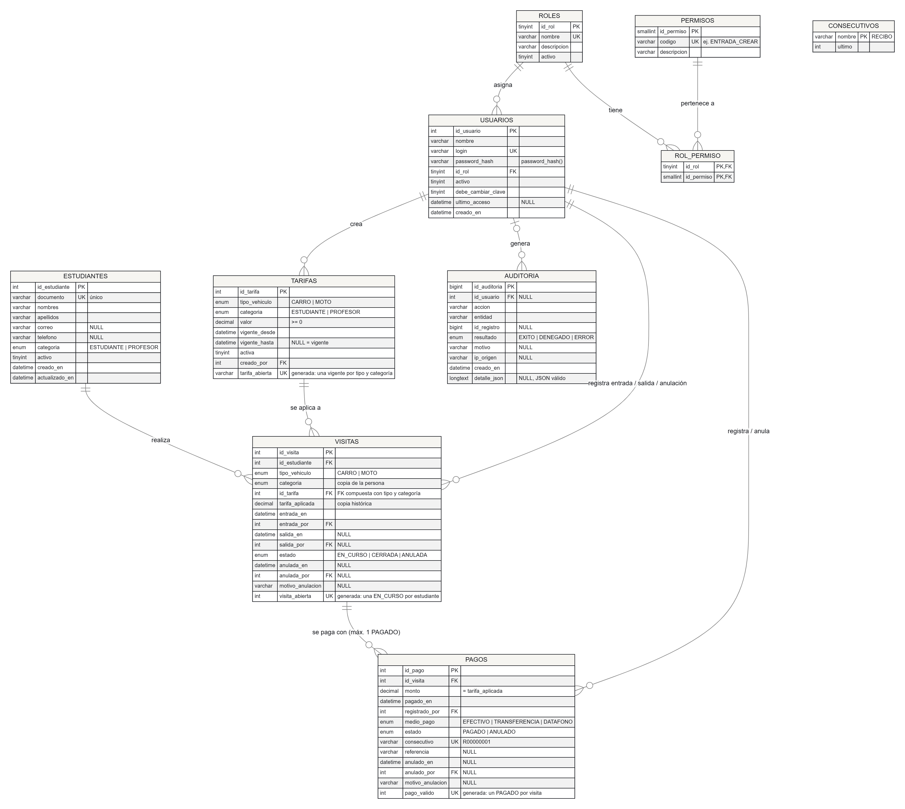

# Modelo de datos · UniPark

Modelo relacional normalizado (3FN) sobre InnoDB y `utf8mb4`.

- **Diagrama:** [`database/diagrams/er-diagram.png`](../database/diagrams/er-diagram.png); la fuente editable está en [`er-diagram.mmd`](../database/diagrams/er-diagram.mmd).
- **Diccionario campo por campo:** [`database/dictionary/data-dictionary.md`](../database/dictionary/data-dictionary.md).
- **Script:** [`database/schema.sql`](../database/schema.sql).



## Entidades

| Tabla | Finalidad |
|---|---|
| `estudiantes` | Identidad mínima de estudiantes y profesores, con su `categoria` |
| `roles`, `permisos`, `rol_permiso` | Control de acceso basado en roles (RBAC) |
| `usuarios` | Cuentas individuales de funcionarios |
| `tarifas` | Valor fijo por tipo de vehículo y categoría, con historial de vigencias |
| `visitas` | Una fila por estancia: entrada, salida, estado y tarifa aplicada |
| `pagos` | Pago y comprobante de cada visita |
| `consecutivos` | Contador de números de comprobante (añadida al modelo preliminar) |
| `auditoria` | Bitácora inmutable de operaciones sensibles |

## Relaciones

| Relación | Cardinalidad | Clave |
|---|---|---|
| estudiante → visitas | 1 : N | `visitas.id_estudiante` |
| tarifa → visitas | 1 : N | `visitas (id_tarifa, tipo_vehiculo, categoria)`, FK compuesta: el tipo y la categoría de la visita deben ser los de la tarifa |
| visita → pagos | 1 : N, con **máximo un PAGADO** | `pagos.id_visita` + `UNIQUE pago_valido` |
| rol → usuarios | 1 : N | `usuarios.id_rol` |
| rol ↔ permisos | N : M | `rol_permiso` |
| usuario → tarifas, visitas, pagos, auditoría | 1 : N | `creado_por`, `entrada_por`, `salida_por`, `anulada_por`, `registrado_por`, `anulado_por`, `id_usuario` |

La relación visita → pagos es 1:N y no 1:1 porque un pago **anulado** conserva su fila. Así, si un cobro se revierte, la visita puede volver a pagarse sin perder el historial. El índice único sobre `pago_valido` mantiene la regla de un solo pago válido.

Ninguna FK usa `ON DELETE CASCADE`: borrar un estudiante, usuario o tarifa con historial es imposible por diseño.

## Estados

```
            registrar entrada
                   │
                   ▼
   ┌──────────── EN_CURSO ────────────┐
   │ anular (Admin, sin pago válido,  │ autorizar salida
   │ motivo obligatorio)              │ (pago PAGADO de esta visita)
   ▼                                  ▼
ANULADA                            CERRADA
(final)                            (final)
```

| Entidad | Estados | Regla en la base |
|---|---|---|
| Visita | `EN_CURSO`, `CERRADA`, `ANULADA` | `ck_visitas_estado`: EN_CURSO sin salida; CERRADA con `salida_en` y `salida_por`; ANULADA con fecha, usuario y motivo. Disparador: los estados finales no cambian. |
| Pago | `PAGADO`, `ANULADO` | `ck_pagos_estado`: ANULADO exige fecha, usuario y motivo. Disparador: un pago solo puede pasar de PAGADO a ANULADO. |
| Usuario | `activo` 1 / 0 | Una cuenta inactiva no inicia sesión y pierde la sesión abierta. |
| Tarifa | vigente (`vigente_hasta` NULL) / histórica | `UNIQUE tarifa_abierta`: una vigente por tipo y categoría (`CARRO-PROFESOR`…). Disparador: el valor no se edita. |

## Restricción crítica: una visita abierta por estudiante (sección 8.3)

```sql
visita_abierta INT UNSIGNED AS (IF(estado = 'EN_CURSO', id_estudiante, NULL)) STORED,
CONSTRAINT uq_visitas_abierta UNIQUE (visita_abierta)
```

Mientras la visita está `EN_CURSO`, la columna vale el id del estudiante; al cerrarse o anularse vale `NULL`. Un índice `UNIQUE` admite muchos `NULL`, pero un solo valor por estudiante. Por eso hay como máximo una visita abierta por estudiante, mientras que el número de visitas cerradas no tiene límite.

Se combinan **las dos alternativas** de la sección 8.3:

1. El servicio bloquea la fila del estudiante con `SELECT … FOR UPDATE` dentro de la transacción. Las entradas simultáneas del mismo estudiante se serializan, y la segunda ve la visita creada por la primera.
2. El índice único es la última barrera ante cualquier camino que omita el servicio (por ejemplo, un `INSERT` manual). La violación (error 1062) se traduce al mismo rechazo controlado.

Comprobado con 6 procesos simultáneos en `tests/Integration/EntradaTest.php` (CP-03).

El mismo patrón protege el pago único (`pago_valido`) y la tarifa vigente única por tipo y categoría (`tarifa_abierta`).

## Categorías y tarifas

Cada persona es **ESTUDIANTE** o **PROFESOR** (`estudiantes.categoria`). Al registrar la entrada se busca la tarifa vigente para `(tipo_vehiculo, categoria)` y se copian en la visita la categoría y el valor. Así, si después la persona cambia de categoría o la tarifa cambia, el historial no se altera. La FK compuesta impide que una visita use la tarifa de otra categoría.

## Datos iniciales

| Archivo | Contenido | Se carga |
|---|---|---|
| `database/base.sql` | Roles, permisos, administrador (`admin` / `Demo2026*`) y las cuatro tarifas vigentes | Siempre |
| `database/seed.sql` | Usuarios por rol, estudiantes y profesores ficticios, tarifas históricas, visitas y pagos | Opcional (demostración) |

## Validaciones de integridad (sección 8.4)

| Validación | Cómo |
|---|---|
| Documento obligatorio y único | `NOT NULL`, `UNIQUE`, `CHECK` de longitud |
| Tarifa no negativa | `CHECK valor >= 0`; el cero se rechaza en PHP salvo `permitir_tarifa_cero` |
| Tarifa aplicada como copia histórica | `visitas.tarifa_aplicada` + disparador |
| `salida_en` ≥ `entrada_en` | `ck_visitas_salida` |
| CERRADA con salida; EN_CURSO sin ella | `ck_visitas_estado` |
| Monto = tarifa aplicada | El servidor toma el monto de la visita; `ReglasVisita::montoCoincide` lo verifica |
| Un pago válido por visita | `UNIQUE pago_valido` |
| Zona horaria consistente | PHP `America/Bogota`; MySQL `SET time_zone = '-05:00'` en cada conexión |
| Retención | Ninguna fila histórica se borra; la política de retención queda pendiente de la institución |
